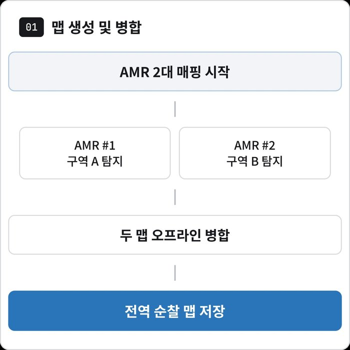
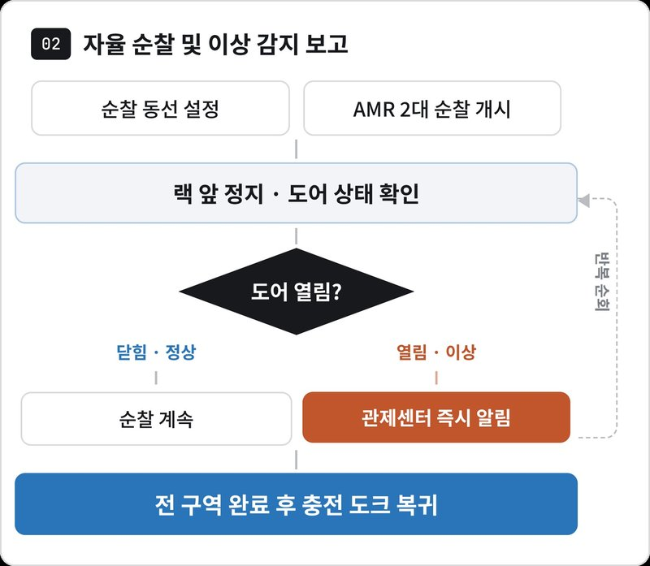
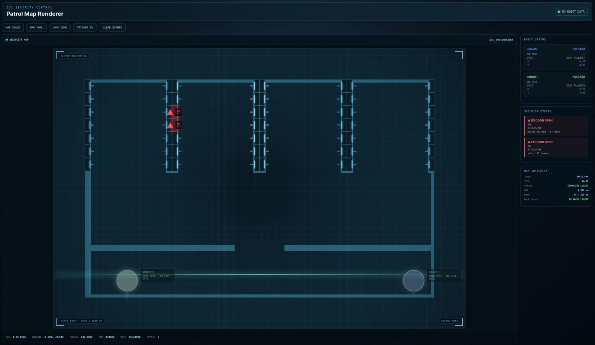
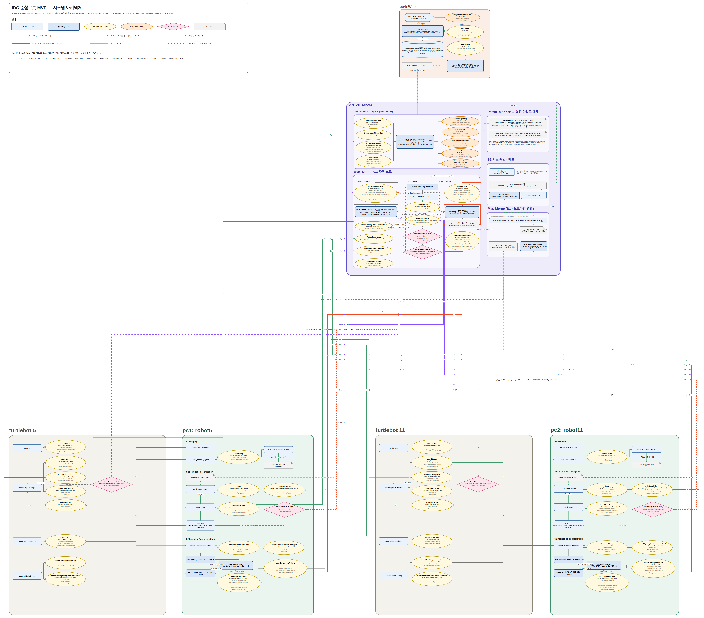
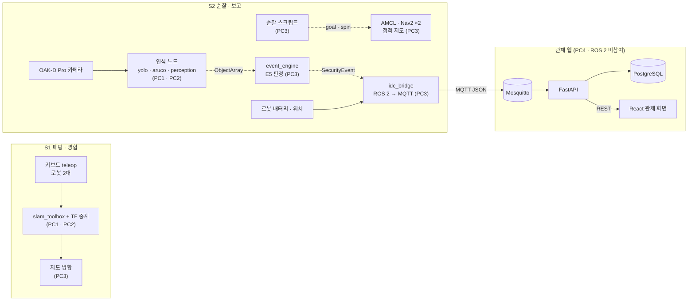
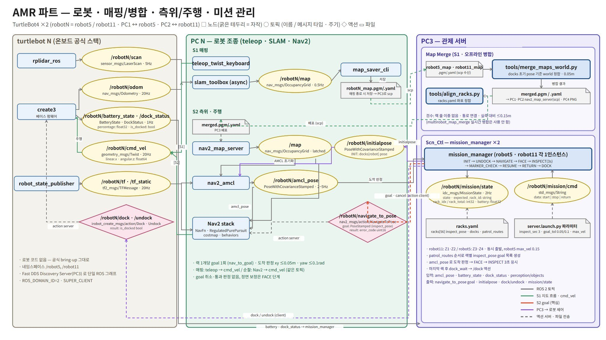
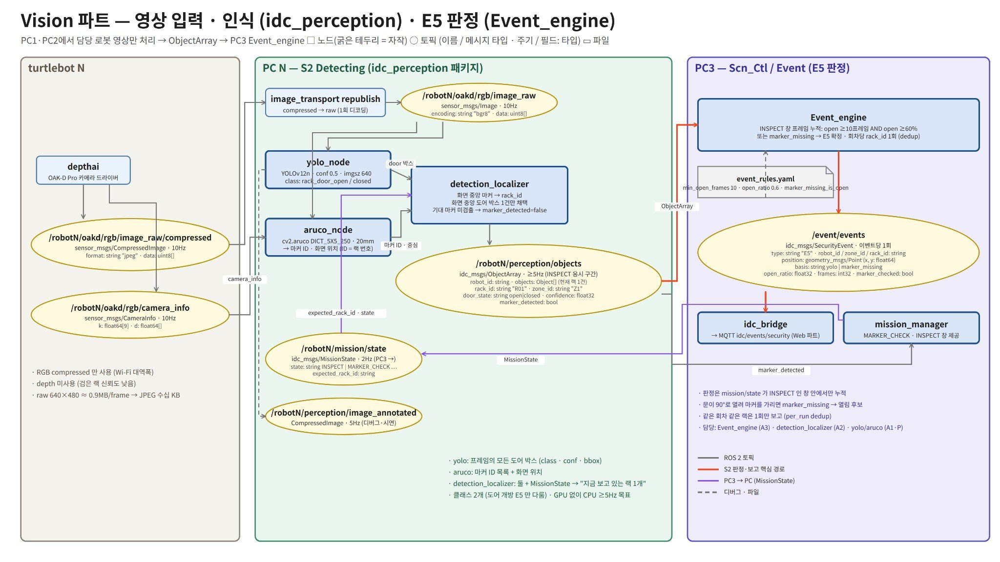
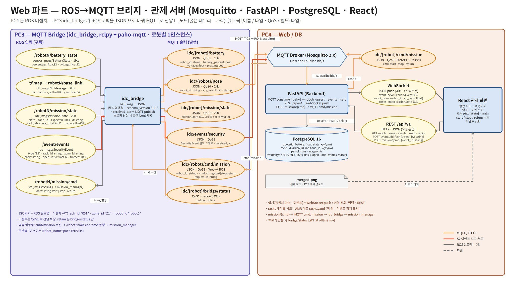

# 🛡️ IDC 순찰 로봇 — TurtleBot4 2대 협업 순찰 및 랙 도어 개방 감지 시스템

<p align="center">
  
  
  
  
  
  
  
  
  
</p>

코로케이션 IDC의 무인 시간대 보안 점검을 자동화하기 위해, **TurtleBot4 2대가 구역을 분담해 순찰**하며 **랙 도어 개폐 상태(YOLO)와 랙 번호(ArUco)를 판별**하고, 개방된 랙을 **보안 이벤트(E5)로 관제 웹에 보고**하는 시스템입니다. 도면 반출이 제한된 현장을 가정해, 순찰 지도 역시 **로봇 2대가 현장에서 직접 작성 · 병합**하도록 설계했습니다.

> 두산로보틱스 ROKEY Boot Camp 9기 · 지능-1 프로젝트 · C-2 · D-2조 합동 **8명** — 남현지(PL) · 황인재(PM) · 정희진 · 정동휘 · 정의석 · 서진우 · 김세은 · 한석형 · 2026.09.04 ~ 09.11(6일)
>
> 팀 저장소 [lambdaramji/rokey_intel1_IDC](https://github.com/lambdaramji/rokey_intel1_IDC)를 fork하여 프로젝트 내용과 담당 역할을 정리한 개인 포트폴리오 버전입니다.
>
> **담당 역할(황인재):** PM — 시스템 아키텍처 설계 · 설계 문서 · 일정 관리 · 데이터 수집 / 라벨링 기준 수립 → [담당 역할](#-담당-역할)

> [!NOTE]
> 이 저장소의 코드는 추후 정리 · 수정할 예정입니다.

## 🎬 시연

<p align="center">
  <br>
  <sub>▲ <b>전반부</b> — 로봇 온보드 카메라 영상에서의 랙 도어 개폐 검출(<code>rack_door_open</code> / <code>rack_door_closed</code>) · <b>후반부</b> — 로봇 2대가 구역을 분담해 작성한 SLAM 지도를 RViz에서 하나의 좌표계로 병합한 결과</sub>
</p>

## 📌 프로젝트 개요

### 배경 및 해결 방안

| 현장 과제 | 해결 방안 |
|---|---|
| 야간 · 주말 상주 인력이 적어, 개방된 랙이 장시간 방치될 수 있음 | 소형 AMR 2대가 무인 시간대에 구역을 분담해 반복 순찰 |
| 랙 개폐 여부를 사람이 직접 순회하며 확인해야 함 | 랙 정면에서 도어 개폐(YOLO)와 랙 번호(ArUco)를 판별해 즉시 보고 |
| 수기 순찰 일지는 누락 여부를 검증하기 어려움 | 로봇 상태와 보안 이벤트를 DB에 자동 기록 |
| 보안상 도면 반출이 제한됨 | 로봇 2대가 현장에서 SLAM 지도를 작성하고 병합 |

6일 일정의 MVP입니다. **기능별 동작은 실기 시연과 검증 기록으로 확인**했으나, 순찰 → 인식 → 이벤트 → 관제를 하나로 연결한 **End-to-End 통합 시연은 기간 내에 수행하지 못했습니다.** 기능별 구현 범위는 [검증 결과 및 한계](#-검증-결과-및-한계)에 정리했습니다.

### 운영 시나리오

```text
S1 매핑 · 병합  원격 조종(teleop)으로 2대 구역 분담 → 로봇별 SLAM(slam_toolbox) → 도크 실측 위치 기준 지도 병합 → 순찰 지도
S2 순찰 · 보고  랙 검사 지점 이동 → 정면 정렬 · 3초 관측 → YOLO 도어 판별 + ArUco 랙 식별 → 다수결 판정 → E5 → MQTT → DB → 관제 화면 → 도크 복귀
```

<p align="center">
  
  &nbsp;
  <br>
  <sub>발표 자료의 플로우차트 — S1 지도 작성 · 병합 / S2 자율 순찰 · 이상 감지 보고</sub>
</p>

**테스트베드** — 3.5 m × 5.6 m 미니 IDC · 검은 폼보드 랙 모형 **56기**(7기 × 8줄) · 막다른 통로 4개(Z1 ~ Z4) · 충전 도크 2개

## ✨ 주요 기능

### 🗺️ 다중 로봇 SLAM 및 지도 병합

운영자가 로봇 2대를 서로 다른 구역으로 원격 조종해 **로봇별 SLAM 지도를 작성**하고, 도크 실측 위치를 기준으로 **두 지도를 공통 world 좌표계에 병합**합니다.

> **구현 상태** — ✅ 2대 동시 매핑 및 병합 지도 표시 시연(발표 영상, 위 GIF 후반부) · 병합 지도 기반 순찰 주행은 미검증

<details>
<summary>세부 구현</summary>

- **로봇별 SLAM:** 로봇마다 namespace(`/robot5`, `/robot11`)를 부여하고, `slam_toolbox`(async)를 각 로봇의 제어 PC(PC1 · PC2)에 분산 실행합니다.
- **TF 접두사 중계(`tf_prefix_relay.py`):** namespace를 지정해도 TF 프레임 이름(`odom` · `base_link` · `map`)에는 접두사가 붙지 않아, 두 로봇이 원점에 중첩되는 프레임 충돌이 발생했습니다. 로봇의 `/robotN/tf`를 구독해 프레임 이름에 `robotN/` 접두사를 붙여 전역 `/tf`로 재발행하도록 했습니다. 이 중계 노드는 로봇 제어 PC에서 SLAM과 함께 실행하고, 관제 서버(PC3)는 world 정렬 · 병합 · RViz 시각화를 담당합니다.
- **지도 병합(`merge_maps_world.py`):** 각 로봇 지도의 셀을 `T(world ← robotN/map)` 변환으로 world 좌표에 투영한 뒤, 두 지도를 포괄하는 world 축 정렬 격자에 셀 상태 우선순위(점유 > 빈 공간 > 미탐색)로 합성합니다. 도크 배치가 고정되어 있다는 점을 활용해, static TF와 병합 스크립트가 동일한 도크 실측 좌표를 사용합니다.
- **코드 위치:** 매핑 · 병합 코드는 팀 저장소 작업 브랜치의 [`amr/`](https://github.com/lambdaramji/rokey_intel1_IDC/tree/gimseeun/20260911-amr-patrol-integration/amr)에 있으며, main(이 fork)에는 병합되지 않았습니다.

</details>

### 🚶 구역 순찰 — 랙 정면 정렬 및 3초 관측

로봇마다 구역 2개(robot11: Z1 → Z2, robot5: Z4 → Z3)를 담당해 **랙 검사 지점으로 이동하고, 랙 정면을 향해 3초간 정지 · 관측**한 뒤 다음 랙으로 이동합니다. 순찰을 마치면 진입 경로를 되짚어 도크로 복귀합니다.

> **구현 상태** — 🟡 순찰 로직 구현 · 실기에서는 정적 지도 기반 검사 지점 3곳 연속 이동까지 확인 · 랙 28기 전체 순찰과 자동 도킹은 실기 미검증

<p align="center">
  <br>
  <sub>실측 도면으로 작성한 정적 지도 — 랙 번호 01 ~ 56, 설계상 순찰 경로(주황: robot11 · 보라: robot5), 빨간 원 = 도크</sub>
</p>

<details>
<summary>세부 구현</summary>

- **정적 지도 · 랙 좌표:** 실측 도면(350 × 560 cm)으로 정적 지도와 `racks.yaml`(랙 56기 · 구역 4 · 도크 2)을 생성해, 순찰 개발과 좌표 검증의 공통 기준 데이터로 사용했습니다([`src/idc_bringup/maps`](src/idc_bringup/maps/README.md)).
- **랙 검사 절차(`patrol.py`):** `MOVE`(Nav2 `NavigateToPose`) → `FACE_RACK`(`Spin`으로 정면 정렬) → `DWELL` 3초. 검사 지점은 통로 중심선 위, 도어까지 수직 거리 0.615 m 지점입니다.
- **실행 구성:** 순찰 단계에서는 PC3가 두 로봇의 AMCL · Nav2(정적 지도)와 순찰 스크립트를 함께 실행하며, robot5가 먼저 출발하고 5초 뒤 robot11이 출발합니다.
- **복귀 · 도킹:** 구역 출구 → 다음 구역 → 진입 통로를 되짚어 도크 앞 → `Dock` 액션. 액션이 SUCCEEDED이고 `is_docked=true`일 때만 순찰 완료로 판정하며, 설정된 도크에서 0.8 m 이상 떨어진 위치에서는 출발을 거부합니다.
- **미연동 구간:** 관측 단계의 카메라 · 인식 연동은 TODO로 남아 있고, 미션 상태(`MissionState`)를 발행하지 않아 순찰과 이벤트 판정 파이프라인이 연결되지 않았습니다.
- **코드 위치:** 팀 저장소 작업 브랜치 [`amr/scripts/robot11_agv`](https://github.com/lambdaramji/rokey_intel1_IDC/tree/gimseeun/20260911-amr-patrol-integration/amr/scripts/robot11_agv) · `robot5_agv`.

</details>

### 👁️ 랙 도어 개방 감지 — YOLO · ArUco · 다수결 판정

랙 정면에서 OAK-D Pro 영상을 입력으로 **YOLO가 도어 개폐(open / closed)를, ArUco 마커가 랙 번호를** 판별합니다. 화면 중심에 가장 가까운 랙 1기만 판정 대상으로 삼아 **관측 구간의 다수결로 개방 여부를 확정**하고, 개방된 랙은 순찰 1회당 한 번만 E5 이벤트로 보고합니다.

> **구현 상태** — ✅ 실제 카메라에서 도어 검출 · 마커 인식(발표 영상, 위 GIF 전반부) · 🟡 이벤트 판정은 합성 데이터 테스트까지

<details>
<summary>세부 구현</summary>

- **`yolo_node`:** YOLOv12n · 클래스 `rack_door_open` / `rack_door_closed` · imgsz 640 · conf 0.5([`perception_params.yaml`](src/idc_perception/config/perception_params.yaml)). 현장 rosbag에서는 기본 신뢰도 임계값(conf 0.5)에서 미검출이 발생해, 임계값을 낮춰 검출을 확인했습니다.
- **`aruco_node`:** `DICT_5X5_250` · 20 mm 마커 · ID 1 ~ 56 = 랙 번호.
- **`perception_node`:** 화면 중심에 가장 가까운 마커로 랙 번호를 결정하고, 해당 랙의 도어 박스 1건만 `ObjectArray`로 발행합니다. 화면 가장자리의 인접 랙은 판정에서 제외합니다.
- **`event_engine`:** 관측 구간 동안 결과를 누적해 **open 프레임 10개 이상 AND 비율 0.6 이상**이면 E5를 발행합니다. 정면에서 기대한 랙의 마커가 검출되지 않으면, 열린 도어가 마커를 가린 것으로 간주해 개방으로 판정합니다(`marker_missing`). 동일 랙은 순찰 1회당 1번만 보고합니다([`event_rules.yaml`](src/idc_event/config/event_rules.yaml)).
- **학습 데이터 · 모델:** 랙 도어 이미지 209장(train 146 · valid 21 · test 42), 데이터 증강 미적용(촬영 조건을 실제 순찰 조건으로 고정). YOLOv8 · v9 · v10 · v11 · v12 · YOLO26 계열로 학습 실험 19건을 진행했고, 최종 후보 YOLOv8n과 YOLOv12n을 비교해 YOLOv12n을 채택했습니다([트러블슈팅](#-트러블슈팅) 참고).
- **검증:** 인식 노드는 합성 스트림 7종, 이벤트 엔진은 합성 시나리오 9건(E5 5건 · 오탐 0 · 중복 0)으로 검증했습니다.

</details>

### 🖥️ 관제 보고 — ROS 2 → MQTT → DB → 웹

관제 서버(PC3)의 `idc_bridge`가 로봇 배터리 · 위치 · 미션 상태 · E5 이벤트를 **JSON으로 직렬화해 MQTT로 전송**하고, ROS 2를 설치하지 않은 관제 웹 PC(PC4)의 **FastAPI가 PostgreSQL에 저장해 React 대시보드**에 표시합니다.

> **구현 상태** — ✅ 실제 robot5의 배터리 · 위치가 DB와 REST API까지 전달됨(9/8 검증) · 🟡 발표 시점 관제 화면에는 로봇 실시간 데이터 미연동

<p align="center">
  <br>
  <sub>발표 시점 관제 화면 — 정적 지도 · 랙 56기 · E5 이벤트 목록. 오른쪽 로봇 상태가 NO DATA로 표시되듯, 실기 로봇 데이터는 연동되지 않았습니다.</sub>
</p>

<details>
<summary>세부 구현</summary>

- **단일 경계 설계:** PC4는 ROS 2에 참여하지 않고, PC3의 `idc_bridge`를 유일한 경계로 두었습니다. 이를 통해 관제 서버 · 웹을 ROS 2 환경과 독립적으로 개발할 수 있도록 했습니다([ADR-001](docs/adr/ADR-001-control-web-architecture.md)).
- **MQTT 토픽:** `idc/{robot}/battery` · `idc/{robot}/pose` · `idc/{robot}/mission/state` · `idc/events/security`(E5) · `idc/{robot}/cmd/*` 등([MQTT 인터페이스 v1](docs/mqtt_interface_v1.md)).
- **인터페이스 우선 설계:** ROS 2 메시지(`idc_msgs`)와 MQTT · 웹 인터페이스를 먼저 동결(SRV-00)한 뒤 서버를 구현해, 로봇 개발과 관제 개발을 병행했습니다.
- **검증(9/8):** 실제 robot5의 배터리(79 % → 58 %)와 위치(약 2 Hz)가 `idc_bridge` → MQTT → PostgreSQL → REST 경로로 전달됐고, REST API는 HTTP 200으로 1초 이내에 응답했습니다([SRV-02 검증 기록](docs/validation/SRV-02_robot_telemetry_e2e_20260908.md)).

</details>

## 🛠️ 시스템 아키텍처

**PC 4대 구성(설계)** — 로봇별 제어 PC(PC1 · PC2)가 SLAM · Nav2 · 인식을, 관제 서버(PC3)가 지도 병합 · 순찰 제어(`mission_manager`) · E5 판정 · `idc_bridge`(ROS 2 ↔ MQTT)를, 관제 웹 PC(PC4)가 MQTT · DB · 웹 대시보드를 담당합니다. PC4는 ROS 2에 참여하지 않고 MQTT로만 연결됩니다.

<p align="center">
  <br>
  <sub>시스템 아키텍처(draw.io) — 로봇 · PC별 노드 · 토픽 · 액션 · MQTT 토픽 · 파일 구성(설계 기준)</sub>
</p>

| 브라우저에서 보기 | 주요 내용 |
|---|---|
| <a href="https://viewer.diagrams.net/?lightbox=1&nav=1#Uhttps%3A%2F%2Fraw.githubusercontent.com%2Fhwang-injae%2Fidc-patrol-robot%2Fmain%2Fdocs%2Fimages%2Fsystem_architecture.drawio"></a> | 위 설계도 확대 · 이동 — 로봇 2대 · PC 4대의 노드 · 토픽 · 액션 · MQTT 토픽 · 파일(설계 기준) |
| <a href="https://htmlpreview.github.io/?https://github.com/hwang-injae/idc-patrol-robot/blob/main/docs/images/archify/index.html#arch"></a> | 인터랙티브 다이어그램 2종 — 시스템 아키텍처(ROS 노드 · 토픽, 노드 23개) · 플로우 차트(S1 / S2 흐름), 설계 기준 · 애니메이션 · 다크 모드 · 내보내기 지원 |

> 두 다이어그램 모두 **설계(SDD v1.2) 기준**입니다. 실제 코드(팀 통합 브랜치 `euiseok/20260910-srv03-int00-integration`)에서는 `mission_manager` 대신 PC3의 순찰 스크립트가 두 로봇의 AMCL · Nav2를 PC3에서 실행하며, 이 스크립트가 미션 상태를 발행하지 않아 순찰과 판정 구간이 연결되지 않았습니다. 구현 · 검증 범위는 [검증 결과 및 한계](#-검증-결과-및-한계)에 정리했습니다.

<details>
<summary>mermaid 흐름도 — 실제 코드 기준, 검증된 경로와 미연결 경로</summary>



<sub>실선 = 발표 영상 또는 검증 기록으로 동작이 확인된 경로 · 점선 = 코드는 있으나 실기 연동 기록이 없는 경로 · 병합 지도는 저장만 하고, 순찰에는 실측 도면 기반 정적 지도를 사용합니다.</sub>

</details>

<details>
<summary>파트별 구성도 3종 — AMR · Vision · 관제(발표 자료, 설계 기준)</summary>

**AMR — 로봇 · 매핑 / 병합 · 위치 추정 / 주행 · 미션 관리**



**Vision — 영상 입력 · 인식(idc_perception) · E5 판정(event_engine)**



**관제 — ROS → MQTT 브리지 · 관제 서버(Mosquitto · FastAPI · PostgreSQL · React)**



</details>

<details>
<summary>패키지 구성 (이 fork의 main 기준)</summary>

| 패키지 | 내용 | 구현 상태 |
|---|---|---|
| `idc_msgs` | 팀 공통 메시지 4종 — `Object` · `ObjectArray`(현재 랙 1건의 도어 상태 · 랙 번호) · `MissionState` · `SecurityEvent`(E5) | 확정 |
| `idc_perception` | `yolo_node`(도어 open / closed) · `aruco_node`(랙 번호) · `perception_node`(화면 중앙 랙 1건으로 정리해 `ObjectArray` 발행) | 구현 · 실제 카메라 기동 확인 |
| `idc_event` | `event_engine` — 관측 구간 다수결 또는 마커 미검출로 E5 확정, 순찰 1회당 랙별 1회 보고 | 구현 · 합성 데이터 테스트 |
| `idc_mission` | `patrol_planner`(`racks.yaml` 순서대로 다음 랙 ID 발행) · `mission_manager` · `fleet_coordinator` · `dock_client` 등 | `patrol_planner` 외 골격 |
| `idc_bringup` | 실측 정적 지도 · `racks.yaml` 생성기, 공통 파라미터, launch | 통합 launch는 골격 |
| `idc_web` | `idc_bridge`(ROS 2 → MQTT) · `backend`(FastAPI · PostgreSQL · MQTT 수신) · `frontend`(React 관제 화면) | 텔레메트리 경로 검증(9/8) |
| `idc_entrance` · `idc_sim` | 확장용 골격 | 빌드 제외 |

</details>

## 📊 검증 결과 및 한계

2026.09.11 발표 기준입니다. 구현 범위가 제한적이었기에, **발표 영상과 검증 기록으로 확인된 항목만** 검증 완료로 분류했습니다.

**검증 완료 항목**

| 기능 | 검증 근거 | 한계 |
|---|---|---|
| 로봇 2대가 구역을 분담해 원격 조종으로 동시에 SLAM 매핑, 두 지도를 하나의 좌표계로 병합해 표시 | 발표 영상(위 GIF 후반부) | 자율 탐사가 아닌 원격 조종 방식. 병합 지도 기반 순찰 주행은 미실시 |
| robot5 실제 카메라에서 랙 도어 open / closed YOLO 검출 | 발표 영상(위 GIF 전반부) | 원격 조종 중 화면으로, 순찰과 연동한 실행 기록 없음. 처리 속도 약 1.5 ~ 3.5 FPS로 목표(5 FPS 이상)에 미달 |
| 같은 실행에서 ArUco 마커로 랙 번호 인식 | 같은 영상의 노드 로그(`markers=[40, 39]`) | 정량적 인식률 미측정 |
| 로봇 배터리 · 위치가 ROS 2 → MQTT → PostgreSQL → REST로 전달 | 9/8 단독 검증([SRV-02](docs/validation/SRV-02_robot_telemetry_e2e_20260908.md)) | 발표 시점 관제 화면에는 로봇 데이터 미연동 |

**미구현 · 미검증 항목**

- **Nav2 기반 전체 순찰** — 랙마다 정지 · 3초 관측하며 순회하는 로직은 코드(작업 브랜치)로 구현했으나, 실기 완주와 자동 도킹 검증 기록은 없습니다.
- **미션 상태 머신 · 2대 순찰 조율** — main에는 골격만 있습니다.
- **실제 순찰 중 이벤트 판정** — 이벤트 엔진은 합성 데이터 단위 테스트까지만 수행했습니다.
- **End-to-End 통합 시연** — 순찰 → 인식 → 이벤트 → 관제 화면으로 이어지는 장면은 없습니다. 발표 관제 화면의 E5 2건은 로봇 데이터 없이 표시된 것입니다.
- **YOLO 독립 테스트셋 평가** — 수행하지 못했습니다(아래 모델 지표 유의사항 참고).

> **모델 지표 관련 유의사항** — 팀은 발표에서 YOLOv12n을 채택하며 검증 mAP50 0.92를 근거로 제시했습니다. 이 값은 **검증셋 21장 기준의 잠정값**이며, train / valid / test가 모두 같은 랙 행(row01 ~ 04)의 이미지로 구성되어 **데이터 누수(data leakage) 가능성**이 있고, **독립 테스트셋 평가는 수행하지 못했습니다.** 실제로 현장 rosbag에서는 기본 임계값(conf 0.5)에서 검출이 잘 되지 않아 임계값을 낮춰 확인해야 했습니다.

## 🙋 담당 역할

**황인재 — PM(Project Manager).** Vision(데이터) 파트로 참여한 뒤 9/7부터 PM을 맡아, 시스템 설계 문서와 일정 · 진행 상황을 관리했습니다. 이 저장소의 코드 · 커밋 · PR(`[PM]` 표기 포함)은 각 파트 담당 팀원이 작성했습니다.

- **시스템 아키텍처 설계 및 시각화** — SDD의 최신 설계 결정을 반영해 PC 4대 전체 구성도(draw.io)와 발표용 파트별 구성도 3종(AMR · Vision · 관제)을 작성하고, 구성도 흐름에 맞춘 파트별 발표 스크립트를 마련했습니다.
- **설계 문서** — 9/8 시나리오 개편(S1 매핑 · 병합 / S2 순찰 · 보고)에 맞춰 요구사항 · 설계 문서(BRD · SRD · SDD)의 작성과 개정에 참여했습니다.
- **일정 및 진행 관리** — 9/7부터 데일리 브리핑으로 팀원별 작업을 배분 · 공지하고, 파트별 진행 상황을 점검하며 일정을 조정했습니다.
- **데이터 수집 · 라벨링 기준 수립** — 라벨링 환경(LabelImg)과 초기 라벨링 가이드 · 검수 규칙을 작성해 배포하고, 랙 도어 데이터 수집 · 라벨링에 참여했습니다. 흰 시트 부착 방식에 맞춘 최종 가이드(v3.0)는 PL이 개정해 확정했습니다.

## 🧩 트러블슈팅

아래는 **팀이 함께 푼 문제**입니다(파트 담당은 [팀 구성 및 역할](#-팀-구성-및-역할), 제가 직접 맡은 일은 [담당 역할](#-담당-역할)).

현장 조건(검은 랙 · 좁은 통로 · 고정 도크)을 설계 제약으로 삼아 풀었습니다. 대표 4건이고, 나머지 3건은 아래에 접어 두었습니다.

| 문제 | 원인 | 어떻게 해결했나 | 결과 |
|---|---|---|---|
| 자율 탐사 매핑이 끊기고 막다른 길을 반복 | 좁은 통로 · frontier가 막다른 곳만 고름 | 자율 탐사 대신 두 로봇이 구역을 나눠 원격 조종으로 매핑 | 2대 동시 매핑 성공 |
| 병합한 지도가 이중으로 겹침(고스트) | 기성 병합 도구의 초기 위치 · 원점 처리 | 도크 실측 위치 기준으로 world 좌표에 직접 병합 | 두 지도를 한 좌표계로 표시 |
| 모델이 도어 열림 · 닫힘을 구분 못 함 | 랙 안팎이 모두 검은색이라 대비가 없음 | 랙 안에 흰 시트를 붙이고 촬영 기준을 정해 재수집 | 209장 학습 · 실제 카메라에서 검출 |
| 도어 판정이 흔들리고 같은 랙을 중복 보고 | 비스듬한 시야 · 인접 랙 · 프레임 하나로 판정 | 랙 정면 3초 관측 · 중앙 랙만 · 구간 다수결 · 순찰당 1회 보고 | 합성 시나리오 9건 중 오탐 0건 · 중복 0건 |

<details>
<summary>나머지 3건 보기 — 다중 로봇 실행 환경 · 모델 선정 · 관제 경계</summary>

| 문제 | 원인 | 어떻게 해결했나 | 결과 |
|---|---|---|---|
| SLAM 2대 실행 시 로봇 겹침 · 스캔 폐기 · 노드 종료 | TF 접두사 없음 · 시계 최대 70초 차이 · 한 PC 과부하 | TF 접두사 재발행 · 시간 동기화 · 로봇별 PC로 SLAM 분산 | 2대 동시 매핑 · 표시(TF는 우회책) |
| 최종 모델 선정(YOLOv8n · YOLOv12n) | YOLOv12n이 더 정확하지만 추론이 2.68 ms 느림 | 검증셋 mAP50 · 도어 혼동률 비교 → YOLOv12n 채택 | mAP50 0.9192 · 혼동률 0.0112(21장 기준 잠정값) |
| 관제 웹을 로봇 없이 개발해야 함 | 처음 설계가 웹 서버와 ROS 2를 한 프로세스로 묶음 | 웹 PC를 ROS 2와 분리 · 인터페이스를 먼저 동결 | 로봇 없이 개발 · 텔레메트리 E2E 통과 |

</details>

## 🌱 회고

**배운 점**

- **데이터 품질은 모델 선정보다 수집 · 라벨링 기준에서 결정됩니다.** 초기 라벨링 가이드에는 박스 규칙만 있고 촬영 각도 · 거리 같은 수집 기준이 없었습니다. 검은 랙 문제와 겹쳐 데이터를 다시 수집해야 했고, 기준대로 라벨링되지 않은 데이터로는 학습이 제대로 이루어지지 않았습니다. 이후로는 소량을 먼저 수집해 라벨링 · 학습까지 한 번 검증한 뒤 기준을 확정하는 절차가 필요하다고 판단합니다.
- **검증 지표는 데이터셋 분할부터 확인해야 합니다.** 검증 mAP는 높았지만 현장 영상에서는 기본 임계값으로 검출이 잘 되지 않았습니다. 분할 규칙이 문서에 있더라도 실제 데이터셋에서 직접 확인해야 한다는 점을 배웠습니다.
- **아키텍처 · 인터페이스는 먼저 고정하고, 통합은 일정 후반에 집중시키지 않아야 합니다.** 9/8 시나리오 개편 이후 남은 사흘 동안 단위 테스트와 통합을 함께 진행하다 보니 통합 시연까지 이르지 못했습니다. 반면 인터페이스를 먼저 동결한 관제 파트는 로봇 없이도 개발을 진행할 수 있었습니다.
- **로봇 자원이 한정된 환경에서는 rosbag 기반 검증이 필수입니다.** 로봇 2대를 여러 파트가 나눠 사용해야 했기 때문에, 녹화한 rosbag으로 인식 · 이벤트 노드를 검증하는 체계가 필요했습니다.

**한계 및 향후 과제**

- 순찰 → 인식 → 이벤트 → 관제를 연결한 통합 시연이 없고, 실기에서 E5를 발생시킨 기록도 없습니다.
- 도어 모델은 독립 테스트셋 평가가 없고 데이터 누수 가능성이 있으며, 처리 속도(1.5 ~ 3.5 FPS)가 목표(5 FPS 이상)에 미달합니다.
- 일정상 제외한 범위: 자율 탐사, LED 이상 감지(E7), 증적 이미지 저장.
- 향후 과제(발표 자료 기준): 자율 탐사 복원 · 마커 기반 자동 정합 / 주행 중 연속 판정 · 재측위 복구 / 조명 · 미세 개방 데이터 보강 / LED 이상 · 적치물 감지 확장 / 증적 이미지 · 자동 복귀

## 👥 팀 구성 및 역할

발표 자료의 역할표 기준이며, 본인(황인재) 행은 확인된 실제 담당에 맞춰 적었습니다.

| 이름 | 역할 | 담당 업무 |
|---|:-:|---|
| 남⁠현⁠지 | PL | 프로젝트 총괄 · 개발 일정표 발행 및 승인, YOLO 학습 총괄, 시스템 통합 리드, ROS 2 인터페이스(`idc_msgs`) 확정, 코드 리뷰 최종 승인, 순찰 경로 생성기 |
| **황⁠인⁠재** | **PM** | 시스템 아키텍처 설계 · 구성도 작성, 설계 문서 작성 · 개정 참여, 일정 및 진행 관리, 데이터 수집 · 라벨링 기준 수립 및 참여 → [담당 역할](#-담당-역할) |
| 정⁠희⁠진 | Vision | 테스트베드 구성, 데이터 수집 · 라벨링, YOLO 모델 학습 |
| 정⁠동⁠휘 | Vision | 테스트베드 구성, 데이터 수집 · 라벨링, ArUco 마커 제작, YOLO 모델 학습 |
| 정⁠의⁠석 | Sys | 관제 서버 · DB(FastAPI + PostgreSQL), 웹 UI(React), ROS 2–MQTT 브리지, 설계 문서(as-built) 갱신, 순찰 경로 생성기, AMR 기능 단위 테스트 |
| 서⁠진⁠우 | AMR | 로봇 · PC 환경 설정, 수동 SLAM 매핑 · rosbag 녹화, Nav2 파라미터 튜닝 |
| 김⁠세⁠은 | AMR | 2대 지도 병합 · 정제, 수동 SLAM 매핑 · rosbag 녹화, AMR 기능 단위 테스트 |
| 한⁠석⁠형 | AMR | 로봇 · PC 환경 설정, 수동 SLAM 매핑 · rosbag 녹화, Nav2 파라미터 튜닝, AMR 기능 단위 테스트 |

## 🤝 협업 방식

6일 동안 **PR 13건(병합 12건)** 을 진행했으며, 작업 ID로 개발 일정표와 PR을 연결하고 인터페이스를 먼저 확정한 뒤 파트별로 병행 개발했습니다.

<details>
<summary>일정 · PR 규칙 · 멀티 PC 구성</summary>

| 날짜 | 단계 | 주요 작업 |
|---|---|---|
| 9/4 | 주제 선정 | 두 조의 후보 주제 중 코로케이션 IDC 순찰로 확정 |
| 9/5 ~ 9/7 | 환경 · 인터페이스 · 데이터 | 저장소 골격 구성 · `idc_msgs` 확정 · MQTT / 웹 인터페이스 동결(ADR-001) · 도어 데이터 수집 착수 |
| 9/8 | 시나리오 개편 | S1 매핑 · 병합 / S2 순찰 · 보고로 범위 조정(E7 · 증적 제외) · 텔레메트리 E2E 검증 |
| 9/9 ~ 9/10 | 학습 · 구현 | 데이터 209장 확정 · 모델 학습 · 인식 노드 · 이벤트 엔진 · 정적 지도 · 순찰 코드 |
| 9/11 | 발표 | 2대 매핑 · 병합, 도어 검출 시연 |

- **작업 ID 체계:** ENV · COL · DAT · TRN · PER · EVT · MAP · MRG · NAV · MIS · SRV · INT · UT 등의 작업 ID로 개발 일정표의 항목과 브랜치 · PR을 연결했습니다.
- **브랜치 · PR 규칙:** 브랜치는 `이름/날짜-작업ID-설명`, PR 제목은 `[파트] 작업ID: 내용` 형식을 사용했습니다. PR 템플릿 · 이슈 템플릿 · CODEOWNERS · [CONTRIBUTING](.github/CONTRIBUTING.md)을 두고, PL이 최종 리뷰 및 승인했습니다.
- **인터페이스 우선 설계:** ROS 2 메시지(`idc_msgs`)와 MQTT · 웹 인터페이스(SRV-00)를 먼저 확정해, 관제 파트는 로봇 없이 개발을 진행했습니다.
- **멀티 PC 구성:** PC 4대 중 ROS 2를 사용하는 3대는 동일한 `ROS_DOMAIN_ID`와 Fast DDS Discovery Server로 연결했습니다.

</details>

## 💻 개발 환경 및 하드웨어

<details>
<summary>펼치기</summary>

| 항목 | 내용 |
|---|---|
| 로봇 | TurtleBot4 × 2 (OAK-D Pro 카메라 · RPLIDAR) |
| PC | 4대 — 로봇별 제어 PC 2대(PC1 · PC2) · 관제 서버 1대(PC3) · 관제 웹 1대(PC4, ROS 2 미설치) |
| 로봇 SW | ROS 2 Jazzy · slam_toolbox · Nav2(AMCL) · Fast DDS Discovery Server |
| 인식 | Ultralytics YOLO(YOLOv12n) · OpenCV ArUco |
| 관제 | Mosquitto(MQTT) · FastAPI · PostgreSQL 16 · React |
| 테스트베드 | 3.5 m × 5.6 m 미니 IDC · 검은 폼보드 랙 모형 56기(7기 × 8줄) · 막다른 통로 4개(Z1 ~ Z4) · 충전 도크 2개 |

</details>

## 🚀 빌드 및 실행

<details>
<summary>펼치기</summary>

- **빌드 · 환경 설정** — [`docs/README_team.md`](docs/README_team.md) (ROS 2 Jazzy · `colcon build`)를 따릅니다. 이 문서의 clone 주소(`yujh5537/rokey_idc_patrol`)는 초기 저장소 기준이며, 현재 팀 저장소는 [lambdaramji/rokey_intel1_IDC](https://github.com/lambdaramji/rokey_intel1_IDC)입니다. 원본 README의 `idc_server`(Flask + SocketIO) 항목은 초기 골격 문구이며, 실제 관제 스택은 [`src/idc_web`](src/idc_web/README.md)의 FastAPI + PostgreSQL + MQTT + React입니다.
- **인식 · 이벤트 노드 현장 배포** — [`docs/runbook/PER-06_field_deploy.md`](docs/runbook/PER-06_field_deploy.md)
- **정적 지도 · 랙 좌표** — [`src/idc_bringup/maps/README.md`](src/idc_bringup/maps/README.md)
- **매핑 · 병합 · 순찰** — 팀 저장소 작업 브랜치의 [`amr/`](https://github.com/lambdaramji/rokey_intel1_IDC/tree/gimseeun/20260911-amr-patrol-integration/amr) 안내를 따릅니다.
- 모델 가중치 · rosbag · 데이터셋은 팀 규칙에 따라 저장소에 포함하지 않았으므로, 도어 검출은 이 저장소만으로는 재현되지 않습니다.

</details>

## 📁 산출물 및 참고 문서

<details>
<summary>저장소 구조 · 주요 문서</summary>

```text
idc-patrol-robot/
├── src/
│   ├── idc_msgs/            메시지 4종
│   ├── idc_perception/      yolo_node · aruco_node · perception_node
│   ├── idc_event/           event_engine (E5 판정)
│   ├── idc_mission/         patrol_planner + 미션 노드 골격
│   ├── idc_bringup/         실측 정적 지도 · racks.yaml · launch
│   ├── idc_web/             idc_bridge · backend(FastAPI) · frontend(React)
│   └── idc_entrance/ · idc_sim/   확장용 골격 (빌드 제외)
├── tools/                   ArUco 마커 시트 생성 · 테스트용 발행기 · 이벤트 엔진 합성 테스트
├── docs/
│   ├── README_team.md       팀 원본 README (환경 설정 · 협업 규칙)
│   ├── adr/ · mqtt_interface_v1.md   관제 경계 설계
│   ├── runbook/             인식 · 이벤트 노드 현장 배포 절차
│   ├── validation/          관제 서버 텔레메트리 검증 (9/8)
│   └── images/              README 이미지 · draw.io 원본 · archify/(인터랙티브 다이어그램 2종)
├── .github/                 협업 규칙 · PR 템플릿 · CODEOWNERS
└── requirements.txt
```

| 문서 | 내용 |
|---|---|
| [ADR-001](docs/adr/ADR-001-control-web-architecture.md) | 관제 웹 경계 설계 — PC4 ROS 2 미참여, `idc_bridge` 단일 경계 |
| [MQTT 인터페이스 v1](docs/mqtt_interface_v1.md) | MQTT 토픽 · JSON 형식 |
| [SRV-02 검증 기록](docs/validation/SRV-02_robot_telemetry_e2e_20260908.md) | 로봇 텔레메트리 ROS 2 → MQTT → DB → REST 검증(9/8) |
| [PER-06 현장 배포](docs/runbook/PER-06_field_deploy.md) | 인식 · 이벤트 노드 현장 배포 절차 |
| [정적 지도 · 랙 좌표](src/idc_bringup/maps/README.md) | 실측 도면 기반 지도 · `racks.yaml` |
| [팀 원본 README](docs/README_team.md) | 환경 설정 · 협업 규칙 |
| [시스템 아키텍처 원본](docs/images/system_architecture.drawio) | draw.io에서 편집 가능한 설계도 원본 |
| [아키파이 다이어그램](docs/images/archify/) | 시스템 아키텍처 · 플로우 차트 HTML과 원본 JSON |

</details>

<div align="center">

**Doosan Robotics ROKEY 9기 · 지능-1 프로젝트 · 코로케이션 IDC AMR 순찰 시스템**

</div>
