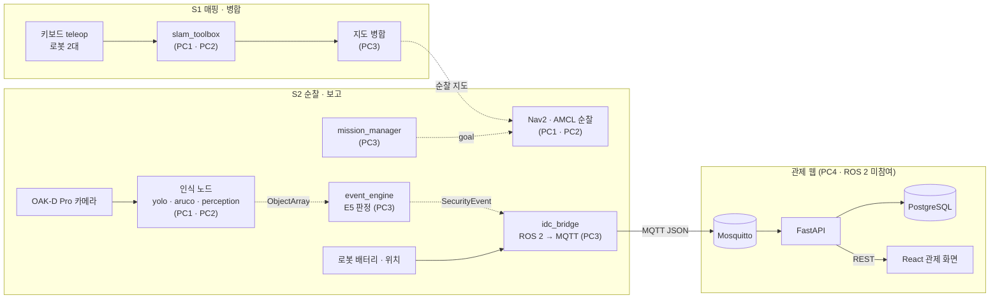

# 🛡️ IDC 순찰 로봇 — TurtleBot4 2대가 나눠 돌며 열린 랙을 찾는다

<p align="center">
  
  
  
  
  
  
  
  
  
</p>

무인 시간대의 코로케이션 IDC에서 **TurtleBot4 2대가 구역을 나눠 순찰**합니다. 랙 앞에 멈춰 정면을 보고 **YOLO로 도어가 열렸는지, ArUco 마커로 몇 번 랙인지** 판별하고, 열린 랙은 **E5 이벤트로 관제 웹에 보고**합니다. 도면을 반출할 수 없는 현장을 가정해, 순찰 지도도 **로봇 2대가 직접 만들어 합칩니다.**

> 두산 로보틱스 ROKEY Boot Camp 9기 · 지능-1 · C-2 · D-2조 합동 **8명** · 2026.09.04 ~ 09.11(6일)
>
> 팀 저장소 [lambdaramji/rokey_intel1_IDC](https://github.com/lambdaramji/rokey_intel1_IDC)를 fork해, 프로젝트 정리와 내가 한 것을 덧붙인 개인 포트폴리오판입니다.
>
> **내 역할(황인재):** PM — 시스템 구조도 · 설계 문서 · 일정 · 데이터 수집 / 라벨링 규칙 → [내가 한 것](#-내가-한-것)

> [!NOTE]
> 이 저장소의 코드는 추후 정리 · 수정할 예정입니다.

## 🎬 데모

<p align="center">
  <br>
  <sub>▲ <b>앞부분</b> — 로봇 카메라 화면의 YOLO 랙 도어 검출(<code>rack_door_open</code> / <code>rack_door_closed</code>) · <b>뒷부분</b> — 로봇 2대가 나눠 주행하며 만든 SLAM 지도가 RViz에서 하나로 합쳐지는 모습</sub>
</p>

## 💡 한눈에

| 현장 문제 | 우리 방법 |
|---|---|
| 야간 · 주말에 상주 인력이 적어, 열린 랙이 몇 시간씩 방치될 수 있다 | 소형 AMR 2대가 무인 시간대에 구역을 나눠 반복 순찰한다 |
| 랙이 열렸는지 사람이 돌아봐야 안다 | 랙 정면에서 도어 열림(YOLO)과 랙 번호(ArUco)를 판별해 바로 보고한다 |
| 수기 순찰 일지는 누락을 확인하기 어렵다 | 로봇 상태와 이벤트를 DB에 자동으로 남긴다 |
| 보안상 도면 반출이 제한된다 | 로봇 2대가 현장에서 SLAM 지도를 만들고 하나로 합친다 |

6일짜리 MVP입니다. **기능별로는 실기 · 검증 기록으로 동작을 확인**했지만, 순찰 → 인식 → 이벤트 → 관제를 하나로 이은 **통합 시연까지는 가지 못했습니다.** 기능마다 어디까지 확인했는지 상태를 함께 적었습니다([결과](#-결과-911-발표-기준)).

```text
S1 매핑 · 병합  teleop으로 2대 구역 분담 → slam_toolbox(로봇별 PC) → 도크 실측 위치 기준으로 두 지도 병합 → 순찰 지도
S2 순찰 · 보고  랙 앞 확인 좌표 → 정면 정렬 · 3초 응시 → YOLO 도어 + ArUco 랙 번호 → 다수결 판정 → E5 → MQTT → DB → 관제 화면 → 도크 복귀
```

<p align="center">
  
  &nbsp;
  <br>
  <sub>발표 자료 플로우차트 — S1 맵 생성 · 병합 / S2 자율 순찰 · 이상 감지 보고</sub>
</p>

**테스트베드** — 3.5 m × 5.6 m 미니 IDC · 검은 폼보드 랙 모형 **56기**(7기 × 8줄) · 막다른 통로 4개(Z1 ~ Z4) · 도크 2개

## ✨ 핵심 기능

### 🗺️ 2대 분담 매핑 · 지도 병합

운영자가 로봇 2대를 서로 다른 구역에 teleop으로 몰아 **각자 SLAM 지도를 만들고**, 도크 실측 위치를 기준으로 **두 지도를 한 좌표계(world)로 합칩니다.**

> **상태** — ✅ 2대 동시 매핑과 병합 지도 표시까지 시연(발표 영상, 위 GIF 뒷부분) · 병합 지도로 순찰한 기록은 없음

<details>
<summary>자세히</summary>

- **로봇별 SLAM:** 로봇마다 namespace(`/robot5`, `/robot11`)를 두고 `slam_toolbox`(async)를 각 로봇의 조종 PC(PC1 · PC2)에서 따로 돌립니다. 메인 서버(PC3)는 병합 · TF 중계 · RViz만 맡습니다.
- **TF 접두사 중계(`tf_prefix_relay.py`):** namespace를 줘도 TF 프레임 이름(`odom` · `base_link` · `map`)에는 접두사가 붙지 않아 두 로봇이 원점에 겹쳤습니다. 로봇의 `/robotN/tf`를 받아 프레임 이름 앞에 `robotN/`을 붙여 전역 `/tf`로 다시 발행합니다.
- **지도 병합(`merge_maps_world.py`):** 각 로봇 지도의 셀을 `T(world ← robotN/map)`로 world 좌표에 옮기고, 두 지도를 덮는 world 축 정렬 격자에 max로 합성합니다(점유 > 빈칸 > 미지). 도크 배치가 고정이라는 점을 이용해, static TF와 병합 스크립트가 같은 도크 실측 좌표를 씁니다.
- **코드 위치:** 매핑 · 병합 코드는 팀 저장소 작업 브랜치의 [`amr/`](https://github.com/lambdaramji/rokey_intel1_IDC/tree/gimseeun/20260911-amr-patrol-integration/amr)에 있고, main(이 fork)에는 병합되지 않았습니다.

</details>

### 🚶 구역 순찰 — 랙 정면 정지 · 3초 응시

로봇마다 구역 2개(robot11: Z1 → Z2, robot5: Z4 → Z3)를 맡아 **랙 앞 확인 좌표로 이동하고, 랙을 정면으로 본 채 3초 멈춘 뒤** 다음 랙으로 갑니다. 끝나면 지나온 통로를 되짚어 도크로 돌아갑니다.

> **상태** — 🟡 순찰 코드까지 · 실기에서는 정적 지도 위 좌표 3개 이동까지 확인 · 28랙 완주와 자동 도킹은 검증 전

<p align="center">
  <br>
  <sub>실측 도면으로 만든 정적 지도 — 랙 번호 01 ~ 56, 설계상 순찰 경로(주황: robot11 · 보라: robot5), 빨간 원 = 도크</sub>
</p>

<details>
<summary>자세히</summary>

- **정적 지도 · 랙 좌표:** 실측 도면(350 × 560 cm)으로 정적 지도와 `racks.yaml`(랙 56기 · 구역 4 · 도크 2)을 생성해, 순찰 개발과 좌표 검증의 단일 기준으로 썼습니다([`src/idc_bringup/maps`](src/idc_bringup/maps/README.md)).
- **랙 1개 방문(`patrol.py`):** `MOVE`(Nav2 `NavigateToPose`) → `FACE_RACK`(`Spin`으로 정면 정렬) → `DWELL` 3초. 확인 좌표는 통로 중심선 위, 도어까지 수직 거리 0.615 m인 지점입니다.
- **복귀 · 도킹:** 구역 출구 → 다음 구역 → 접근 통로를 되짚어 도크 앞 → `Dock` 액션. 액션이 SUCCEEDED이고 `is_docked=true`일 때만 순찰 완료로 봅니다. 설정 도크에서 0.8 m 넘게 떨어진 곳에서는 출발을 거부합니다.
- **남은 연결:** 응시 중 카메라 · 인식 연동은 TODO로 남아 있고, 미션 상태(`MissionState`)를 발행하지 않아 인식 · 이벤트 쪽 응시 구간과 이어지지 않습니다.
- **코드 위치:** 팀 저장소 작업 브랜치 [`amr/scripts/robot11_agv`](https://github.com/lambdaramji/rokey_intel1_IDC/tree/gimseeun/20260911-amr-patrol-integration/amr/scripts/robot11_agv) · `robot5_agv`.

</details>

### 👁️ 열린 랙 도어 탐지 — YOLO + ArUco + 다수결 판정

랙 정면에서 OAK-D Pro 영상으로 **YOLO가 도어 open / closed를, ArUco 마커가 랙 번호를** 판별합니다. 화면 중앙의 랙 1개만 골라 **응시 구간 다수결로 열림을 확정**하고, 열린 랙은 순찰 1회에 한 번만 E5로 보고합니다.

> **상태** — ✅ 실제 카메라에서 도어 검출 · 마커 인식(발표 영상, 위 GIF 앞부분) · 🟡 이벤트 판정은 합성 데이터 테스트까지

<details>
<summary>자세히</summary>

- **`yolo_node`:** YOLOv12n · 클래스 `rack_door_open` / `rack_door_closed` · imgsz 640 · conf 0.5([`perception_params.yaml`](src/idc_perception/config/perception_params.yaml)). 현장 rosbag에서는 conf 0.5로 박스가 잘 나오지 않아 낮춰서 확인했습니다.
- **`aruco_node`:** `DICT_5X5_250` · 20 mm 마커 · ID 1 ~ 56 = 랙 번호.
- **`perception_node`:** 화면 중앙에 가장 가까운 마커로 랙 번호를 정하고, 그 랙의 도어 박스 1건만 `ObjectArray`로 냅니다. 화면 가장자리의 이웃 랙은 판정에서 뺍니다.
- **`event_engine`:** 응시 구간 동안 쌓아 **open 프레임 10개 이상 AND 비율 0.6 이상**이면 E5를 냅니다. 정면에서 기대한 랙의 마커가 안 보이면, 열린 문이 마커를 가린 것으로 보고 개방으로 판정합니다(`marker_missing`). 같은 랙은 순찰 1회에 1번만 보고합니다([`event_rules.yaml`](src/idc_event/config/event_rules.yaml)).
- **학습 데이터 · 모델:** 랙 도어 사진 209장(train 146 · valid 21 · test 42), 증강 없음(촬영 조건을 실제 순찰 조건으로 고정). 10개 버전을 비교해 YOLOv12n을 골랐습니다([기술적 도전](#-기술적-도전--해결) 참고).
- **검증:** 인식 노드는 합성 스트림 7종, 이벤트 엔진은 합성 9케이스(E5 5건 · 오탐 0 · 중복 0)로 확인했습니다.

</details>

### 🖥️ 관제 보고 — ROS 2 → MQTT → DB → 웹

메인 서버(PC3)의 `idc_bridge`가 로봇 배터리 · 위치 · 미션 상태 · E5를 **JSON으로 바꿔 MQTT로** 보내고, ROS 2가 없는 관제 PC(PC4)의 **FastAPI가 PostgreSQL에 저장해 React 화면**에 보여 줍니다.

> **상태** — ✅ 실제 robot5의 배터리 · 위치가 DB와 REST까지 도달(9/8 검증) · 🟡 발표 시점 화면에는 로봇 실시간 데이터가 연결되지 않음

<p align="center">
  <br>
  <sub>발표 시점 관제 화면 — 정적 지도 · 랙 56기 · E5 이벤트 목록. 오른쪽 로봇 상태가 NO DATA인 것처럼, 실기 로봇 데이터는 들어오지 않았습니다.</sub>
</p>

<details>
<summary>자세히</summary>

- **관제 경계:** PC4는 ROS 2에 참여하지 않고, 경계를 PC3의 `idc_bridge` 한 곳에 뒀습니다. 그래서 관제 서버 · 웹을 ROS 없이 개발할 수 있습니다([ADR-001](docs/adr/ADR-001-control-web-architecture.md)).
- **MQTT 토픽:** `idc/{robot}/battery` · `idc/{robot}/pose` · `idc/{robot}/mission/state` · `idc/events/security`(E5) · `idc/{robot}/cmd/*` 등([MQTT 인터페이스 v1](docs/mqtt_interface_v1.md)).
- **인터페이스 먼저:** ROS 2 메시지(`idc_msgs`)와 MQTT · 웹 인터페이스를 먼저 동결(SRV-00)한 뒤 서버를 구현했습니다.
- **검증(9/8):** 실제 robot5의 배터리(79 % → 58 %)와 위치(약 2 Hz)가 `idc_bridge` → MQTT → PostgreSQL → REST로 도달했고, REST는 HTTP 200으로 1초 안에 응답했습니다([SRV-02 검증 기록](docs/validation/SRV-02_robot_telemetry_e2e_20260908.md)).

</details>

## 🛠️ 시스템 구조

**PC 4대** — 로봇별 조종 PC(PC1 · PC2)가 SLAM · Nav2 · 인식을, 메인 서버(PC3)가 지도 병합 · 미션 · 이벤트 판정을, 관제 웹 PC(PC4)가 MQTT · DB · 웹 화면을 맡습니다. PC4는 ROS 2에 참여하지 않고, 둘 사이 경계는 PC3의 `idc_bridge`(ROS 2 → MQTT)입니다.



<sub>실선 = 발표 영상이나 검증 기록으로 동작을 확인한 경로 · 점선 = 설계했지만 실기에서 이어서 동작한 기록이 없는 경로</sub>

<details>
<summary>파트별 구조도 3장 — AMR · Vision · 관제(발표 자료, 설계 기준 · PM 정리)</summary>

설계 기준 그림이라, `mission_manager`처럼 main에는 골격만 있는 노드도 들어 있습니다. 실제로 어디까지 됐는지는 [결과](#-결과-911-발표-기준)를 봐 주세요.

**AMR — 로봇 · 매핑 / 병합 · 측위 / 주행 · 미션 관리**


**Vision — 영상 입력 · 인식(idc_perception) · E5 판정(event_engine)**


**관제 — ROS → MQTT 브리지 · 관제 서버(Mosquitto · FastAPI · PostgreSQL · React)**


</details>

<details>
<summary>패키지 구성 (이 fork의 main 기준)</summary>

| 패키지 | 내용 | main 상태 |
|---|---|---|
| `idc_msgs` | 팀 공통 메시지 4종 — `Object` · `ObjectArray`(현재 랙 1건의 도어 상태 · 랙 번호) · `MissionState` · `SecurityEvent`(E5) | 확정 |
| `idc_perception` | `yolo_node`(도어 open / closed) · `aruco_node`(랙 번호) · `perception_node`(화면 중앙 랙 1건으로 정리해 `ObjectArray` 발행) | 구현 · 실제 카메라로 기동 확인 |
| `idc_event` | `event_engine` — 응시 구간 다수결 또는 마커 미검출로 E5 확정, 순찰 1회에 랙당 1번 | 구현 · 합성 데이터 테스트만 |
| `idc_mission` | `patrol_planner`(`racks.yaml`의 순서대로 다음 랙 ID 발행) · `mission_manager` · `fleet_coordinator` · `dock_client` 등 | `patrol_planner` 외에는 골격 |
| `idc_bringup` | 실측 정적 지도 · `racks.yaml` 생성기, 공통 파라미터, launch | 통합 launch는 골격 |
| `idc_web` | `idc_bridge`(ROS 2 → MQTT) · `backend`(FastAPI · PostgreSQL · MQTT 수신) · `frontend`(React 관제 화면) | 텔레메트리 경로 검증(9/8) |
| `idc_entrance` · `idc_sim` | 확장용 빈 골격 | 빌드 제외 |

</details>

## 📊 결과 (9/11 발표 기준)

구현에 성공한 범위가 넓지 않습니다. 발표 영상과 검증 기록으로 확인되는 것만 "된 것"에 넣었습니다.

**된 것**

| 기능 | 확인 근거 | 한계 |
|---|---|---|
| 로봇 2대가 구역을 나눠 teleop으로 동시에 SLAM 매핑, 두 지도를 한 좌표계로 합쳐 표시 | 발표 영상(위 GIF 뒷부분) | 자율 탐사가 아니라 사람이 조종. 병합 지도로 순찰한 기록은 없음 |
| robot5 실제 카메라에서 랙 도어 open / closed YOLO 검출 | 발표 영상(위 GIF 앞부분) | teleop 중 화면이며 순찰과 연동해 돌린 기록은 없음. 처리 속도 약 1.5 ~ 3.5 FPS로 목표(5 FPS 이상)에 못 미침 |
| 같은 실행에서 ArUco 마커로 랙 번호 인식 | 같은 영상의 노드 로그(`markers=[40, 39]`) | 인식률을 체계적으로 잰 기록은 없음 |
| 로봇 배터리 · 위치가 ROS 2 → MQTT → PostgreSQL → REST로 전달 | 9/8 단독 검증([SRV-02](docs/validation/SRV-02_robot_telemetry_e2e_20260908.md)) | 발표 시점 관제 화면에는 로봇 데이터가 들어오지 않음 |

**못 한 것**

- **Nav2 순찰 완주** — 랙마다 정지 · 3초 응시하며 도는 순찰은 코드(작업 브랜치)까지 있고, 실기 완주 · 자동 도킹 검증 기록이 없습니다.
- **미션 상태 머신 · 2대 순찰 조율** — main에는 골격만 있습니다.
- **이벤트 엔진을 실제 순찰에서 동작** — 합성 데이터 단위 테스트까지만 했습니다.
- **통합 시연** — 순찰 → 인식 → 이벤트 → 관제 화면으로 이어진 장면은 없습니다. 발표 관제 화면의 E5 2건은 로봇 데이터 없이 표시된 것입니다.
- **YOLO 봉인 테스트셋 평가**

> **모델 수치에 대해** — 팀은 발표에서 YOLOv12n을 채택하고 검증 mAP50 0.92를 근거로 들었습니다. 이 값은 **검증셋 21장 기준 잠정값**이고, train / valid / test가 모두 같은 랙 줄(row01 ~ 04)의 사진에서 나와 **분할 누수 가능성**이 있으며, **봉인 테스트셋 평가는 하지 못했습니다.** 실제로 현장 rosbag에서는 기본 임계값(conf 0.5)으로 박스가 잘 나오지 않아 임계값을 낮춰 확인해야 했습니다.

## 🙋 내가 한 것

**황인재 — PM.** Vision(데이터) 담당으로 시작해, 9/7부터 PM을 맡아 설계 문서 · 일정 · 진행을 관리했습니다. 이 저장소의 코드와 커밋 · PR(`[PM]` 표기 포함)은 각 파트 담당 팀원이 올린 것입니다.

- **시스템 구조도 · 발표** — PC 4대 전체 구조도(draw.io)와 발표용 파트별 구조도 3장(AMR · Vision · 관제, [시스템 구조](#-시스템-구조)의 그림)을 SDD의 최신 결정에 맞춰 정리하고, 그림을 따라 읽는 파트별 발표 스크립트를 만들었습니다.
- **설계 문서** — 9/8 시나리오 개편(S1 매핑 · 병합 / S2 순찰 · 보고)에 맞춘 요구사항 · 설계 문서(BRD · SRD · SDD) 작성과 개정에 참여했습니다.
- **일정 · 진행** — 9/7부터 팀원별 할 일을 정해 알리고, 진행 상황을 받아 일정을 조정했습니다.
- **데이터** — 라벨링 환경(LabelImg)과 초기 라벨링 가이드 · 검수 규칙을 만들어 팀에 배포하고, 랙 도어 데이터 수집 · 라벨링에 참여했습니다. 흰 종이를 붙여 다시 찍는 방식에 맞춘 최종 가이드(v3.0)는 PL이 개정해 확정했습니다.
- **모델 실험** — YOLOX nano · s 후보를 학습했습니다(증강 없음 · 100 epoch). 평가 체계가 달라 YOLO 후보와 비교하지 못해 채택 후보에서 빠졌습니다.

## 🧩 기술적 도전 · 해결

계획대로 안 된 것이 많았습니다. **안 되는 방식은 빨리 접고, 현장 조건(검은 랙 · 좁은 통로 · 고정 도크)을 이용하는 방식으로** 바꿨습니다.

| 문제 | 원인 → 해결 | 결과 |
|---|---|---|
| 자율 탐사(frontier)로 지도를 만들려 했지만 경로가 끊기고 같은 막다른 통로를 반복 | 좁은 통로라 costmap 여유가 부족하고, frontier가 막다른 통로 · 모퉁이를 반복 선택, 후진 회피도 안 됨 → 파라미터 완화로도 안 풀려 **사람이 teleop으로 구역을 나눠 매핑** | 2대 동시 매핑 성공(자율 탐사는 범위에서 제외) |
| 두 로봇 지도를 합치면 이중으로 겹침(Ghost) | 기성 `multirobot_map_merge`가 초기 위치를 픽셀 단위 · 격자 모서리 기준으로 적용하고 출력 원점을 강제, SLAM 오차도 쌓임 → **도크 실측 위치 기준으로 world 좌표에 직접 래스터화**하는 병합 스크립트 | 두 지도를 한 좌표계로 표시(영상) |
| 도어가 열렸는지 닫혔는지 모델이 구분하지 못함 | 랙 외부 · 내부가 모두 검정이라 명도 차가 없고, 촬영 각도 · 거리 기준도 없었음 → **랙 안쪽에 흰 A4**를 붙이고 각도 · 거리 촬영 가이드를 정해 처음부터 다시 수집 | 209장으로 학습, 실제 카메라에서 open / closed 검출 |
| 비스듬히 보면 문이 안쪽을 가리고, 이웃 랙이 함께 잡힘 | 사각 시야 · 화면 가장자리의 이웃 랙 → **랙 정면(도어까지 0.615 m)에서 정렬 · 3초 응시**하고 **화면 중앙 랙 1개만** 판정 | 판정 기준을 순찰 동작(응시 구간)과 맞춤 |

<details>
<summary>6건 더 보기 — 다중 로봇 TF · 시간 동기화 · PC 부하 · 판정 규칙 · 모델 선택 · 관제 경계</summary>

| 문제 | 원인 → 해결 | 결과 |
|---|---|---|
| 두 로봇 SLAM을 켜면 RViz에서 로봇 모델이 원점에 겹침 | namespace를 줘도 TF 프레임 이름에는 접두사가 안 붙음 → `tf_prefix_relay.py`로 `robotN/` 접두사를 붙여 전역 `/tf`로 재발행 | 2대 동시 표시(근본 해결이 아닌 우회책) |
| 스캔이 계속 버려져 지도가 자라지 않음 | 메인 PC에 시간 동기화(chrony)가 없어 로봇과 시계가 최대 70초 벌어짐 → chrony 설치 · 동기화 | 스캔 유실 해소 |
| SLAM 2대를 한 PC에서 돌리면 스캔 유실 · 병합 노드 비정상 종료 | CPU · 네트워크 부하 → SLAM은 로봇별 조종 PC(PC1 · PC2)로 나누고, PC3는 병합 · 중계 · RViz만 | 2대 동시 매핑 |
| 한 프레임으로 판정하면 흔들리고 같은 랙을 여러 번 보고 | → 응시 구간 다수결(open 10프레임 이상 · 60 % 이상), 순찰 1회에 랙당 1번, 마커가 가려지면 `marker_missing`으로 개방 판정 | 합성 9케이스 오탐 0 · 중복 0 |
| 모델 후보 YOLOv8n과 v12n 중 선택 | 검증셋 기준 mAP50 0.8838 → **0.9192**, 도어 혼동률 0.0449 → **0.0112**, 추론 +2.68 ms → 정확도 · 혼동률 우위로 **YOLOv12n** | 단, 검증셋 21장 기준 잠정값(위 [모델 수치](#-결과-911-발표-기준) 참고) |
| 관제 웹을 로봇 없이 개발해야 함 | PC4는 ROS 2에 참여하지 않고 PC3 `idc_bridge` 한 곳에서 JSON / MQTT로 경계(ADR-001) → 인터페이스 먼저 동결 | 서버 · 웹을 로봇 없이 개발, 텔레메트리 E2E 통과 |

</details>

## 🌱 배운 점 · 한계

**배운 점**

- **데이터는 모델보다 촬영 · 라벨 기준이 먼저입니다.** 처음 라벨링 가이드에는 박스 규칙만 있고 촬영 각도 · 거리 같은 수집 기준이 없었습니다. 검은 랙 문제와 겹쳐 데이터를 다시 모아야 했고, 규칙대로 라벨링되지 않은 데이터로는 학습이 제대로 되지 않았습니다. 다음에는 소량을 먼저 찍어 라벨링 · 학습까지 한 번 돌려 본 뒤 기준을 확정하겠습니다.
- **검증 점수는 분할부터 의심해야 합니다.** 검증 mAP는 높았지만 현장 영상에서는 기본 임계값으로 박스가 잘 나오지 않았습니다. 분할 규칙이 문서에 있어도 실제 데이터셋에서 직접 확인해야 합니다.
- **아키텍처 · 인터페이스를 먼저 고정하고, 통합은 일정 맨 끝에 두지 않아야 합니다.** 9/8 시나리오 개편 뒤 남은 사흘 안에 단위 테스트와 통합을 모두 넣다 보니 통합 시연까지 가지 못했습니다. 인터페이스를 먼저 동결한 관제 쪽은 로봇 없이도 개발이 진행됐습니다.
- **로봇은 한정돼 있으니 rosbag을 써야 합니다.** 로봇 2대를 여러 파트가 나눠 써야 해서, 녹화해 둔 rosbag으로 인식 · 이벤트 노드를 확인하는 방식이 필요했습니다.

**한계와 다음 과제**

- 순찰 → 인식 → 이벤트 → 관제를 이은 통합 시연이 없고, 실기에서 E5를 낸 기록도 없습니다.
- 도어 모델은 봉인 테스트셋 평가가 없고 분할 누수 가능성이 있으며, 처리 속도(1.5 ~ 3.5 FPS)가 목표(5 FPS 이상)에 못 미칩니다.
- 계획에서 뺀 것: 자율 탐사, LED 이상(E7), 증적 사진 저장.
- 다음 과제(발표 자료 기준): 자동 탐사 복원 · 마커 기반 자동 정합 / 주행 중 연속 판정 · 재측위 복구 / 조명 · 미세 개방 데이터 보강 / LED 이상 · 적치물 확장 / 증적 이미지 · 자동 복귀

## 👥 팀 · 역할

발표 역할표 기준이며, 이름 대신 역할로 적었습니다.

| 역할 | 인원 | 담당 |
|---|:-:|---|
| PL | 1 | 프로젝트 총괄 · 개발 일정표 발행 · 승인, YOLO 학습 총괄, 시스템 통합 리드, ROS 2 인터페이스(`idc_msgs`) 확정, 코드 리뷰 최종 승인, 순찰 경로 생성기 |
| **PM (본인)** | 1 | 시스템 아키텍처 설계, 일정, 데이터 수집 · 라벨링 규칙, YOLO 모델 학습, 설계 문서 갱신 → [내가 한 것](#-내가-한-것) |
| Vision | 2 | 테스트베드 구성, 데이터 수집 · 라벨링, ArUco 마커 제작, YOLO 모델 학습 |
| Sys | 1 | 관제 서버 · DB(FastAPI + PostgreSQL), 웹 UI(React), ROS 2–MQTT 브리지, 설계 문서 갱신, 순찰 경로 생성기, AMR 기능 단위 테스트 |
| AMR | 3 | 로봇 · PC 환경 설정, 수동 SLAM 매핑 · rosbag 녹화, 2대 지도 병합 · 정제, Nav2 파라미터 튜닝, AMR 기능 단위 테스트 |

## 🤝 개발 · 협업 방식

6일 동안 **PR 13개(병합 12)** · 작업 ID로 일정표와 PR을 연결했고, 인터페이스를 먼저 확정한 뒤 파트별로 나눠 개발했습니다.

<details>
<summary>일정 · PR 규칙 · 멀티 PC</summary>

| 날짜 | 단계 | 한 일 |
|---|---|---|
| 9/4 | 주제 선정 | 두 조 주제 중 코로케이션 IDC 순찰로 확정 |
| 9/5 ~ 9/7 | 환경 · 인터페이스 · 데이터 | 저장소 골격 · `idc_msgs` 확정 · MQTT / 웹 인터페이스 동결(ADR-001) · 도어 데이터 수집 시작 |
| 9/8 | 시나리오 개편 | S1 매핑 · 병합 / S2 순찰 · 보고로 범위 조정(E7 · 증적 제외) · 텔레메트리 E2E 검증 |
| 9/9 ~ 9/10 | 학습 · 구현 | 데이터 209장 마감 · 모델 학습 · 인식 노드 · 이벤트 엔진 · 정적 지도 · 순찰 코드 |
| 9/11 | 발표 | 2대 매핑 · 병합, 도어 검출 시연 |

- **작업 ID:** ENV · COL · DAT · TRN · PER · EVT · MAP · MRG · NAV · MIS · SRV · INT · UT 같은 작업 ID로 개발 일정표의 행과 브랜치 · PR을 연결했습니다.
- **브랜치 · PR:** 브랜치는 `이름/날짜-작업ID-설명`, PR 제목은 `[파트] 작업ID: 내용`. PR 템플릿 · 이슈 템플릿 · CODEOWNERS · [CONTRIBUTING](.github/CONTRIBUTING.md)을 두고, PL이 최종 리뷰 · 승인했습니다.
- **인터페이스 먼저:** ROS 2 메시지(`idc_msgs`)와 MQTT · 웹 인터페이스(SRV-00)를 먼저 확정해, 관제 쪽은 로봇 없이 개발했습니다.
- **멀티 PC:** PC 4대 중 ROS 2를 쓰는 3대는 같은 `ROS_DOMAIN_ID`와 Fast DDS Discovery Server로 묶었습니다.

</details>

## 💻 개발 환경 · 장비

<details>
<summary>펼치기</summary>

| 항목 | 내용 |
|---|---|
| 로봇 | TurtleBot4 × 2 (OAK-D Pro 카메라 · RPLIDAR) |
| PC | 4대 — 로봇별 조종 PC 2(PC1 · PC2) · 메인 서버 1(PC3) · 관제 웹 1(PC4, ROS 2 미설치) |
| 로봇 SW | ROS 2 Jazzy · slam_toolbox · Nav2(AMCL) · Fast DDS Discovery Server |
| 인식 | Ultralytics YOLO(YOLOv12n) · OpenCV ArUco |
| 관제 | Mosquitto(MQTT) · FastAPI · PostgreSQL 16 · React |
| 테스트베드 | 3.5 m × 5.6 m 미니 IDC · 검은 폼보드 랙 모형 56기(7기 × 8줄) · 막다른 통로 4개(Z1 ~ Z4) · 도크 2개 |

</details>

## 🚀 설치 · 실행

<details>
<summary>펼치기</summary>

- **빌드 · 셋업** — [`docs/README_team.md`](docs/README_team.md)(ROS 2 Jazzy · `colcon build`)를 따릅니다. 원본 README의 `idc_server`(Flask + SocketIO) 항목은 초기 골격 문구이고, 실제 관제 스택은 [`src/idc_web`](src/idc_web/README.md)의 FastAPI + PostgreSQL + MQTT + React입니다.
- **인식 · 이벤트 노드 현장 배치** — [`docs/runbook/PER-06_field_deploy.md`](docs/runbook/PER-06_field_deploy.md)
- **정적 지도 · 랙 좌표** — [`src/idc_bringup/maps/README.md`](src/idc_bringup/maps/README.md)
- **매핑 · 병합 · 순찰** — 팀 저장소 작업 브랜치의 [`amr/`](https://github.com/lambdaramji/rokey_intel1_IDC/tree/gimseeun/20260911-amr-patrol-integration/amr) 안내를 따릅니다.
- 모델 가중치 · rosbag · 데이터셋은 팀 규칙에 따라 저장소에 넣지 않았습니다. 그래서 도어 검출은 이 저장소만으로는 재현되지 않습니다.

</details>

## 📁 문서

<details>
<summary>저장소 구조 · 주요 문서</summary>

```text
idc-patrol-robot/
├── src/
│   ├── idc_msgs/            메시지 4종
│   ├── idc_perception/      yolo_node · aruco_node · perception_node
│   ├── idc_event/           event_engine (E5 판정)
│   ├── idc_mission/         patrol_planner + 미션 노드 골격
│   ├── idc_bringup/         실측 정적 지도 · racks.yaml · launch
│   ├── idc_web/             idc_bridge · backend(FastAPI) · frontend(React)
│   └── idc_entrance/ · idc_sim/   확장용 골격 (빌드 제외)
├── tools/                   ArUco 마커 시트 생성 · 테스트용 발행기 · 이벤트 엔진 합성 테스트
├── docs/
│   ├── README_team.md       팀 원본 README (셋업 · 협업 규칙)
│   ├── adr/ · mqtt_interface_v1.md   관제 경계 설계
│   ├── runbook/             인식 · 이벤트 노드 현장 배치 절차
│   ├── validation/          관제 서버 텔레메트리 검증 (9/8)
│   └── images/              README 그림
├── .github/                 협업 규칙 · PR 템플릿 · CODEOWNERS
└── requirements.txt
```

| 문서 | 내용 |
|---|---|
| [ADR-001](docs/adr/ADR-001-control-web-architecture.md) | 관제 웹 경계 설계 — PC4 ROS 2 미참여, `idc_bridge` 단일 경계 |
| [MQTT 인터페이스 v1](docs/mqtt_interface_v1.md) | MQTT 토픽 · JSON 형식 |
| [SRV-02 검증 기록](docs/validation/SRV-02_robot_telemetry_e2e_20260908.md) | 로봇 텔레메트리 ROS 2 → MQTT → DB → REST 검증(9/8) |
| [PER-06 현장 배치](docs/runbook/PER-06_field_deploy.md) | 인식 · 이벤트 노드 현장 배치 절차 |
| [정적 지도 · 랙 좌표](src/idc_bringup/maps/README.md) | 실측 도면 기반 지도 · `racks.yaml` |
| [팀 원본 README](docs/README_team.md) | 셋업 · 협업 규칙 |

</details>

<div align="center">

**Doosan Robotics ROKEY 9기 · 지능-1 프로젝트 · 코로케이션 IDC AMR 순찰 시스템**

</div>
